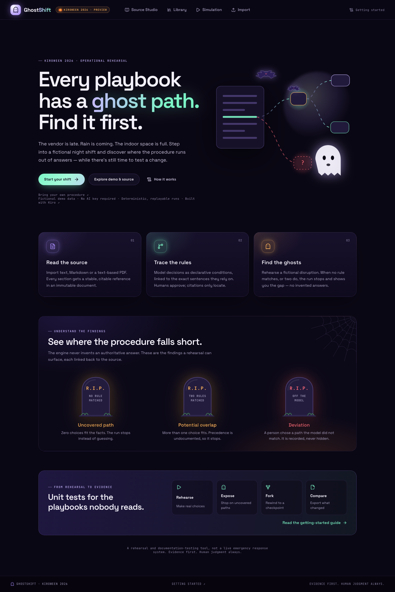
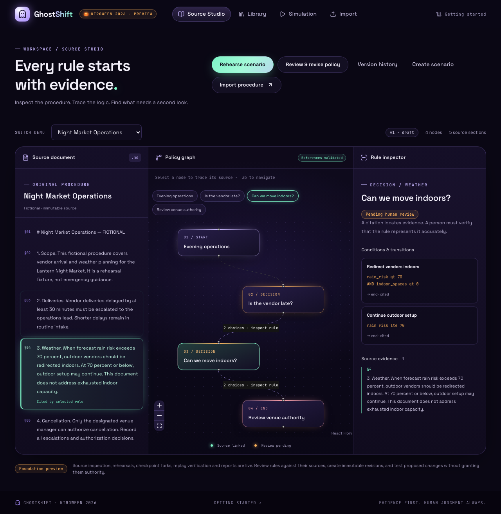
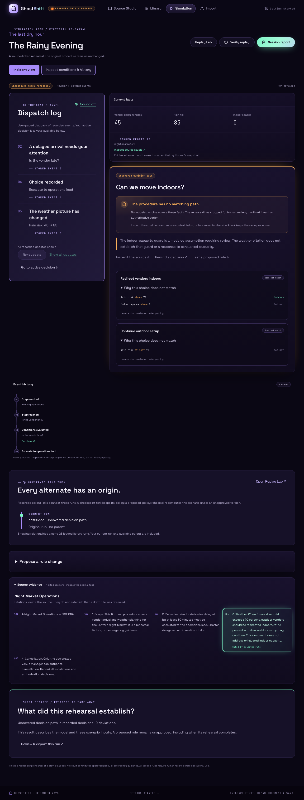
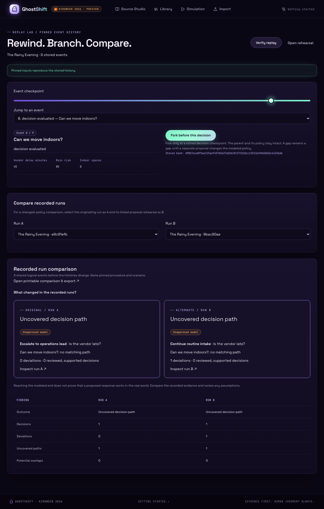

# GhostShift 👻

**Unit tests for the real-world playbooks nobody reads.**



Every procedure has a *ghost path*: a situation the document never actually covers. GhostShift
turns static procedures into **source-linked decision graphs**, rehearses fictional disruptions
through a deterministic engine, and **stops** when no rule matches or two rules conflict, instead
of inventing an answer. Then you fork the timeline, test an explicitly unapproved fix, and compare
the actual outcomes. Built for Kiroween 2026 (Frankenstein category).

| | |
| --- | --- |
| 📄 **Read the source** | Import text, Markdown or a text-based PDF into an immutable document with stable, citable sections and page provenance. |
| 🕸️ **Trace the rules** | Declarative conditions (no `eval`), validated destinations and real citations. Only explicit human review approves a rule. |
| 👻 **Find the ghosts** | Rehearse fictional scenarios. Zero matches means an uncovered path; multiple matches means an overlap; a nonmatching choice is a deviation. |
| ⏪ **Rewind & fork** | Append-only event ledger, verified deterministic replay, and checkpoint forks that never alter the parent. |
| 🧪 **Test a change** | Save unapproved proposals, rehearse them, and compare against the preserved original. |
| 🧾 **Keep the evidence** | Printable after-action and comparison reports; JSON exports with quoted sources, replay inputs and hashes. |

### 60-second tour

1. `make install && make dev`, then open http://localhost:5173.
2. **Start your shift** opens the fictional Night Market briefing. Acknowledge the draft and start.
3. Choose *Escalate to operations lead*. **Show all updates** reveals the actual recorded dispatches.
4. Rain risk rises to 85 and indoor capacity is 0. **The procedure has no matching path.** That's the ghost.
5. **Test a proposed rule** opens a human-authored experiment. Add a choice for current facts, enter
   your action and reason, save, acknowledge its unapproved status, then rehearse and compare.
6. Verify replay, then export the parent/alternate comparison. Source Studio and Replay Lab remain
   available for inspecting citations and same-policy checkpoint forks.

| Source Studio | Simulation Room | Replay Lab |
| --- | --- | --- |
|  |  |  |

All demo data is fictional. GhostShift is a rehearsal and documentation-testing tool, not a live
emergency response system. No AI key or external service is required. Visual design notes:
[docs/DESIGN.md](docs/DESIGN.md).

## What's implemented

Kiroween 2026 local preview: inspect source-linked procedures, rehearse real decisions, expose
missing or conflicting rules, fork checkpoints, compare outcomes, and export after-action reports.
Both fictional fixtures run through the same deterministic engine. Seeded graphs remain **drafts**.

Implemented: source import/inspection, deterministic engine, persisted sessions and event history,
optimistic choice concurrency, replay verification, checkpoint forks, comparison, Simulation Room,
source evidence, JSON reports and print layout; manual rule authoring, human approval, immutable
source/playbook revisions, saved proposals and proposed-policy replay/comparison. Public-demo
hardening is implemented and tested locally; live hosting verification remains. Workspace library,
custom scenarios, version history, PDF text import, Replay Lab and portable comparison reports are
also implemented. See [local product completion](docs/PRODUCT_COMPLETION.md).
No AI key or external service is required by the running application.

The cinematic incident view adds a user-paced dispatch log, actual fact changes, source-linked
findings, recorded branch relationships and a before/after debrief. Exact demo versions receive
authored fictional atmosphere; custom/proposed versions receive neutral event-derived text.
See [incident experience](docs/INCIDENT_EXPERIENCE.md), the prepared [submission draft](docs/submission-draft.md),
and [release readiness](docs/RELEASE_READINESS.md) for the local narrated video and remaining launch steps.

## Build status

Dependencies and both lockfiles are complete. Backend/frontend lint, type checks, 154 backend tests,
24 frontend unit tests, 31 development browser tests plus one production-path Caddy browser test,
and the production frontend build pass as of November 4, 2026. The local release quality pass
also verified source/scenario save recovery, scenario value types, missing-record recovery and
responsive journeys at 360, 390, 768 and 1440 px. Desktop/mobile/tablet and print captures were inspected.
See the [quality review](docs/QUALITY_REVIEW.md) for fixes, evidence and verification limits.
See docs/VALIDATION.md for exact commands/results and remaining limits.
[Actual local screenshots](docs/screenshots/README.md) document the fictional demo workflows.

## Local setup

Prerequisites: Python 3.12, uv, Node 22.12+ and npm. From repository root:

```sh
make install
make dev
```

Open http://localhost:5173. API docs: http://127.0.0.1:8000/docs.
`make dev` migrates/seeds SQLite, then starts both services. Stop with Ctrl-C.
Data persists in services/api/ghostshift.db. Rerunning seed is safe.
An optional .env.example documents variables; native processes read exported environment values,
not a .env file automatically. DATABASE_URL defaults to sqlite:///./ghostshift.db from services/api.

Separate terminals: `make seed`, then `make api` and `make web`.
Docker alternative: `docker compose up --build` (or `docker-compose up --build` if Compose
is installed as a standalone command; persistent named volume, local ports only).
Docker is local development configuration, not production hosting.

## Engine milestone

Run both fictional fixtures through the same real interpreter:

```sh
make engine-demo
```

It reports `uncovered` at Night Market's weather decision and `overlap` at Customer Support's
refund decision. This developer harness explicitly uses draft `auto_rehearsal` mode. Library runs
pause for user choices by default. The browser uses the real persisted simulation API.

Kiro wrote the initial engine specification, implementation and 60 tests in one real CLI session.
Codex reviewed it, corrected gaps, and added 22 regression/property tests locally. No further Kiro
model calls were made after the user's credit-conservation request. See [Kiro evidence](docs/kiro-evidence.md)
and [engine review](docs/ENGINE_REVIEW.md) for exact attribution and limitations.

## Rehearse in the browser

Open Explore demo → Rehearse scenario. Acknowledge the fictional, unapproved model and start.
Choose escalation, inspect the real weather/capacity gap, then use Fork here on the earlier delivery
checkpoint. An alternate routine-intake choice records a deviation. Compare with the preserved
parent, verify replay, and open Session report to download the actual JSON or print it.

Reloading the run URL restores its stored state and history. Customer Support instead stops when
both refund rules match. Forks keep the same pinned procedure. To test a policy change, expand
**Propose a rule change**, enter a reason, add/edit a choice and save. Explicitly acknowledge the
unapproved proposal, rehearse, choose the proposed action, then compare with the parent.
The alternate remains a draft even when it completes.
See [persisted rehearsal design](docs/PERSISTED_REHEARSALS.md) for the authority and event invariants.

## Model and review procedures

Import text/Markdown or a text-based PDF → **Model decision rules** → **Add decision before completion**. Enter conditions and
choose actual source sections, then save the draft revision. **Review & revise policy** in Source
Studio opens individual evidence review and revision editing. Source changes create immutable
snapshots and clear previous citations. Approval requires explicit human confirmation; uncited
rules and proposal snapshots cannot be approved. A separate cited revision must be reviewed.
See [policy workflow](docs/POLICY_REVIEW.md) for the exact invariants and API additions.

Use **Create scenario** from your saved model to enter typed facts and scheduled changes.
**Library** finds saved sources, models, scenarios and runs. **Version history** shows related
revisions; **Replay Lab** inspects events, forks checkpoints and compares actual saved runs.
Session/comparison exports include cited text, replay inputs and durable events.
PDF uploads are limited to unencrypted text-based files, 256 KiB and 20 pages; extraction needs
human checking. No OCR or original binary storage is included. Details: [product workflows](docs/PRODUCT_COMPLETION.md).

## Public-demo isolation and deployment

The optional public mode gives visitors separate signed, expiring SQLite workspaces. It enforces
request/rate/storage limits, purges expired data, and serves the built app through Caddy. Local
development keeps its existing database. No public URL has been deployed. See
[hardening and limits](docs/PUBLIC_DEMO.md) and [server handoff](docs/DEPLOYMENT.md).

`make e2e-public` validates the production build and Caddy/API flow on loopback using temporary test
data. It requires the Caddy CLI (2.11.7 was verified). Production Docker images now pass a local Linux/arm64 browser journey, restart persistence and
expiry cleanup (`make e2e-containers`). Target-server deployment and real HTTPS remain unverified. GitHub Actions CI (lint, typecheck, tests, both
browser suites including the Caddy production path, and dependency audits) passes on `main`.

## Verification

```sh
make lint
make typecheck
make test
cd apps/web && npx playwright install chromium
cd ../.. && make e2e
cd apps/web && npm run build
```

Playwright starts real API and Vite servers and uses actual SQLite API writes. Use an isolated
DATABASE_URL for browser tests if you need to preserve a clean development database.
See docs/VALIDATION.md for commands actually run and remaining environment limitations.

## Layout and contracts

- apps/web: React/TypeScript/Vite, Tailwind, local shadcn-style button primitive, React Flow,
  TanStack Query, React Router, Zod, Lucide, Vitest and Playwright.
- services/api: FastAPI, Pydantic v2 graph schemas, SQLAlchemy models, Alembic migration,
  document/fixture/simulation services, deterministic engine, pytest and Hypothesis tests.
- fixtures: fictional runbooks, graph definitions and seeded scenario input JSON.
- docs: PRD, architecture, demo/submission notes, next Kiro tasks and verification record.
- .kiro: genuine Kiro engine specs and session evidence, plus labeled Codex steering/review notes
  and remaining source/replay/hook placeholders.

Implemented API: GET /api/health, GET /api/demo, POST /api/documents,
GET /api/documents/{id}, POST /api/playbooks, GET /api/playbooks/{id},
GET /api/scenarios/{id}, POST /api/sessions, GET /api/sessions/{id}, choice/fork/replay/report routes and run comparison.
Also implemented: GET /api/library, GET /api/documents/{id}/models,
GET /api/playbooks/{id}/history, POST /api/scenarios and POST /api/documents/pdf.
See docs/PRODUCT_COMPLETION.md, docs/PERSISTED_REHEARSALS.md, docs/POLICY_REVIEW.md or /docs on the running API for exact paths.
POST documents accepts JSON {title,content,source_type: "text" | "markdown"}.
POST playbooks accepts {document_id,title,graph}. All new graphs are drafts.
No simulation or approval endpoint returns pretend success.

Read [PRD](docs/PRD.md), [architecture](docs/architecture.md), and
[next Kiro tasks](docs/NEXT_KIRO_TASKS.md). MIT licensed. This is a rehearsal tool using fictional
examples; citations require human interpretation and do not establish policy approval.
